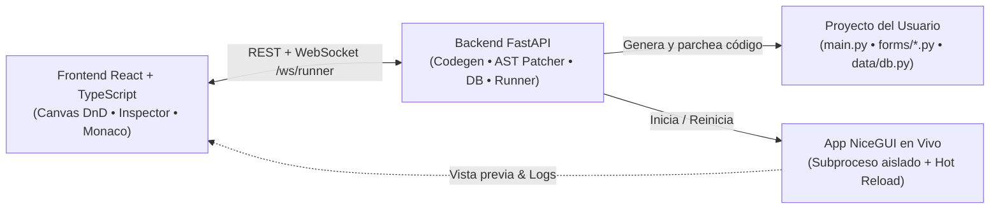

<div align="center">

# Quantum-RAD Studio

### Visual Python IDE powered by **NiceGUI**

[](https://www.python.org/)
[](https://nicegui.io/)
[](https://fastapi.tiangolo.com/)
[](https://react.dev/)
[](https://tailwindcss.com/)
[](LICENSE)

*Diseñá interfaces web y de escritorio en Python arrastrando y soltando controles, conectalos a bases de datos SQL en segundos, editá tu lógica con autocompletado real de NiceGUI y empaquetá tu aplicación lista para distribuir.*

[Características](#-características-principales) • [Arquitectura](#-arquitectura) • [Instalación Rápida](#-instalación-rápida) • [Atajos](#-atajos-de-teclado) • [Documentación](docs/GUIA_USUARIO.md)

</div>

---

## ✨ Características Principales

### 🎨 Diseñador Visual Drag & Drop (76 Widgets de NiceGUI 4.0)
- **Catálogo completo de 76 controles** organizados en 5 categorías: *Layout*, *Básicos*, *Entradas*, *Datos y Gráficos* (`Table`, `AG Grid`, `EChart`, `Highchart`, `Plotly`, `uPlot`, `Leaflet`, `Tree`, `Scene 3D`) y *Multimedia / Feedback*.
- **Anidamiento preciso** en contenedores (`Column`, `Row`, `Card`, `Grid`, `Expansion`, `Dialog`, `Scroll Area`, `Header`, `Footer`, `Left/Right Drawer`) con *Document Outline* interactivo.
- **Personalización visual completa**:
  - **Selector de color libre + Paleta oficial completa de Tailwind CSS** (22 familias × 11 tonos `50 → 950`) disponible en fondo de página (`body`), controles, estilos Tailwind, Quasar y CSS inline.
  - **Más de 150 props de Quasar** organizados en 7 secciones desplegables con buscador y selector visual de **Material Icons** (+120 iconos).
  - **7 plantillas de formulario** listas para usar (*En blanco*, *Login*, *Dashboard KPI*, *CRUD con DB*, *Configuración*, *Landing*, *Menú Maestro*).

### 🧩 Patrón Code-Behind (estilo Visual Studio / WinForms)
Cada formulario se divide en 3 archivos sincronizados de forma segura para que el diseñador **nunca sobrescriba tu código**:

| Archivo | Rol | Edición |
| :--- | :--- | :--- |
| `forms/<nombre>.ngui.json` | Árbol visual, estilos, eventos, bindings y configuración de página | Diseñador Visual |
| `forms/<nombre>_designer.py` | Código Python/NiceGUI autogenerado (`setup_ui`) | Automático al guardar |
| `forms/<nombre>.py` | Tu lógica de negocio y manejadores de eventos (`on_btn_click`, etc.) | Editor Monaco (protegido por AST) |

- **Doble clic en cualquier widget** → inyecta el *handler* en `forms/<nombre>.py` mediante análisis AST sin perder código previo y salta directo a la línea en el editor.
- **Editor Monaco con IntelliSense vivo de NiceGUI 4.0**: autocompletado de `self.`, `self.<widget>.` (métodos reales inspeccionados desde NiceGUI) y `ui.`.

### 🗄️ Diseñador Visual de Base de Datos & RAD CRUD
- **Explorador y diseñador visual SQLite / SQLAlchemy**: creá bases de datos, tablas, columnas, tipos, claves foráneas (`FK`) y consultá registros en vivo sin escribir SQL.
- **Generador CRUD en 1 clic**: generá formularios completos de Alta, Baja, Modificación y Búsqueda (con `AG Grid` o `ui.table`) conectados a tu tabla.
- **Data Binding automático**: vinculá directamente `table`, `aggrid`, `echart`, `highchart`, `plotly`, `uplot`, `select`, `radio`, `toggle`, `tree` y `leaflet` a tablas de tu DB.
- **Reactive Bindings (`nicegui.binding`)**: enlazá propiedades entre controles (`from_control`, `two_way`) o con `app.storage.user` de forma visual.

### ⚡ Ejecución, Hot Reload y Empaquetado Integrado
- **Runner integrado con Hot Reload**: ejecutá tu proyecto (`F5`), visualizalo embebido en la pestaña *Vista Previa* con barra de rutas y recarga automática al guardar (`Ctrl+S`).
- **Consola, Terminal y Gestor de Paquetes `pip`** integrados en el panel inferior.
- **Empaquetador desde la app**: exportá tus proyectos creados con Quantum-RAD Studio a `.zip`, ejecutable `.exe` con **PyInstaller** o instalador de Windows con **Inno Setup**.

---

## 🏗️ Arquitectura



---

## 🚀 Instalación Rápida

### Opción 1: Instalación automática en Windows (recomendada)
Ejecutá el instalador incluido que configura el entorno virtual Python, instala dependencias y compila el frontend:

```bat
installer\install.bat
```

Luego abrí **Quantum-RAD Studio** con:

```bat
installer\run_studio.bat
```

### Opción 2: Arranque manual (modo producción unificado)

```powershell
# 1. Backend
cd backend
python -m venv .venv
.\.venv\Scripts\activate
pip install -r requirements.txt

# 2. Frontend
cd ..\frontend
npm install
npm run build

# 3. Iniciar servidor unificado (http://127.0.0.1:8010)
cd ..
.\backend\.venv\Scripts\python.exe launcher.py --port 8010
```

> **Modo desarrollo (Vite + Uvicorn con recarga):**
> - Backend: `.\backend\.venv\Scripts\python.exe -m uvicorn app.main:app --app-dir backend --reload --port 8010`
> - Frontend: `cd frontend && npm run dev` (disponible en `http://localhost:5173`)

---

## ⌨️ Atajos de Teclado

| Atajo | Acción |
| :--- | :--- |
| `Ctrl + S` | Guardar formulario/código (regenera `_designer.py` y dispara Hot Reload) |
| `F5` | Ejecutar / Reiniciar aplicación NiceGUI |
| `Ctrl + Z` / `Ctrl + Y` | Deshacer / Rehacer cambios en el diseñador |
| `Ctrl + C` / `Ctrl + V` | Copiar / Pegar widget seleccionado |
| `Delete` | Eliminar widget seleccionado |
| `Doble clic` en widget | Crear/ir al manejador del evento principal en código |

---

## 📁 Estructura del Proyecto

```text
nicegui-studio/
├── backend/
│   ├── app/
│   │   ├── models/          # Esquemas Pydantic (IR del formulario, DB, runner)
│   │   ├── routers/         # Endpoints REST y WebSocket (projects, designer, database, runner, tools)
│   │   └── services/        # Codegen (76 widgets), AST patcher, CRUD generator, DB, runner
│   ├── tests/               # Suite de pruebas Pytest
│   └── requirements.txt
├── frontend/
│   └── src/
│       ├── components/      # Canvas visual, Inspector, Monaco, DB Designer, Docs, Modals
│       ├── registry/        # Catálogo de 76 widgets + catálogo Tailwind/Quasar
│       ├── store/           # Estado global Zustand (IDE y Diseñador)
│       └── services/        # Cliente API tipado
├── installer/               # Scripts de instalación, PyInstaller y plantilla Inno Setup
├── docs/                    # Guía de usuario completa
├── projects/                # Espacio de trabajo para tus aplicaciones NiceGUI
├── launcher.py              # Lanzador unificado de producción
└── pyproject.toml
```

---

## 🧪 Pruebas

```powershell
cd backend
.\.venv\Scripts\python.exe -m pytest -v
```

---

## 📖 Documentación

Consultá la guía completa paso a paso en [**docs/GUIA_USUARIO.md**](docs/GUIA_USUARIO.md) o directamente dentro de la pestaña **Documentación** integrada en el IDE.

---

## 🔒 Seguridad y Uso Local

> **Importante:** **Quantum-RAD Studio** está diseñado como un entorno de desarrollo **local** (`127.0.0.1`). Dado que incluye terminal integrada, gestión de paquetes `pip` y ejecución de subprocesos Python, **no debe exponerse directamente a internet** sin una capa de autenticación y aislamiento adecuada.

---

## 📄 Licencia y Avisos

Distribuido bajo la licencia **MIT**. Consultá [LICENSE](LICENSE) y las licencias de librerías de terceros en [THIRD_PARTY_LICENSES.txt](THIRD_PARTY_LICENSES.txt).

> **Aviso de marca:** *Quantum-RAD Studio* es un proyecto comunitario independiente y no está afiliado, respaldado ni patrocinado oficialmente por **Zauberzeug GmbH** ni por el equipo de **NiceGUI**. Todas las marcas y nombres de librerías pertenecen a sus respectivos propietarios.
